# Phase 24 — Enterprise Admin Portal
## Project: VoiceGuard AI (SIH Problem Statement: SIH26104)
### AI-Powered Real-Time Detection and Prevention of Voice Cloning Impersonation Attacks

---

## 1. Executive Summary

Phase 24 establishes the **VoiceGuard AI Enterprise Admin Portal**—a centralized governance and administration interface that enables platform and organization administrators to manage multi-tenant boundaries, access entitlements, algorithmic policies, biometric baselines, external telephony integrations, and immutable audit trails across the VoiceGuard AI ecosystem.

The Admin Portal integrates seamlessly with the existing FastAPI backend (`voiceguard-ai/backend`), unified SQLite persistence (`voiceguard.db`), and React 19 + TypeScript frontend (`voiceguard-ai/frontend`), preserving strict server-side tenant isolation, role-based access control (RBAC), and privacy safeguards for sensitive voice biometric data.

---

## 2. Architecture & Design Principles

```mermaid
flowchart TD
    subgraph UI["Admin Portal UI (React 19 + TypeScript + Vite)"]
        Nav["Admin Navigation & Tenant Switcher"]
        Overview["Platform Overview KPIs"]
        Tenants["Organization & Tenant Governance"]
        Identity["Users & RBAC Permission Matrix"]
        Security["Policies & Biometrics Governance"]
        Ops["Integrations, Retention & AI Inventory"]
        Audit["Audit Trail & Regulatory Reports"]
    end

    subgraph AuthGuard["Authorization & Tenant Boundary Guard"]
        Bearer["JWT Bearer Authentication (/api/v1/auth/login)"]
        RBACGuard["require_permission(perm_code)"]
        TenantGuard["enforce_tenant_isolation(user, org_id)"]
    end

    subgraph BackendAPI["FastAPI Admin Endpoints (/api/v1/admin/*)"]
        OrgService["Organization Service"]
        UserService["User & Account Service"]
        RoleService["RBAC & Permission Catalog"]
        PolicyService["Security Policy Engine"]
        BiometricService["Privacy-Safe Voice Profile Service"]
        DeviceService["Hardware Device Registry"]
        IntegrationService["Integration & Diagnostics Probe"]
        AIService["AI Model Inventory & Rollback"]
        RetentionService["Data Retention & Legal Hold Engine"]
        AuditService["Immutable SHA-256 Audit Logger"]
    end

    subgraph Storage["Unified Persistence (SQLite / voiceguard.db)"]
        OrgTable["organizations"]
        UserTable["users (with organization_id FK)"]
        PermTable["permissions & role_permissions"]
        PolicyTable["security_policies"]
        IntegrationTable["integration_configs"]
        RetentionTable["retention_policies"]
        ModelTable["model_service_configs"]
        AuditTable["admin_audit_logs"]
    end

    UI --> AuthGuard
    AuthGuard --> BackendAPI
    BackendAPI --> Storage
```



### Core Architecture Pillars:
1. **Server-Side Tenant Isolation**:
   - Platform Administrators (`superadmin`, `admin`) possess global cross-tenant visibility.
   - Organization Administrators (`org_admin`) are locked to their own `organization_id`. Any attempt to access, mutate, or query another tenant's users, integrations, or logs throws an immediate `403 Forbidden` (`TENANT_ISOLATION_VIOLATION`).
2. **Biometric Privacy Protections**:
   - In compliance with GDPR, CCPA, and BIPA, raw acoustic audio waveforms and 512-dimensional vector embeddings are never exposed to administrative endpoints or frontend views.
   - Profiles are managed via opaque speaker IDs, enrollment confidence scores, consent flags, and cryptographic token references.
3. **Secret Credential Redaction**:
   - Telephony trunks, SMS API tokens, and push keys are masked upon persistence (`••••••••••••••••`) and only unmasked internally during live diagnostic probes.
4. **Tamper-Evident Audit Logging**:
   - Every administrative mutation (creation, modification, suspension, activation, rollback, or deletion) generates an immutable audit record containing the administrator's identity, timestamp, IP address, resource type, action, and structured delta payload.

---

## 3. RBAC Entitlement Matrix

VoiceGuard AI enforces 24 granular permissions across 10 functional modules:

| Permission Code | Category | Name | Roles Granted |
|:---|:---|:---|:---|
| `organizations:read` | organizations | View Organizations | superadmin, admin, org_admin, read_only_admin |
| `organizations:write` | organizations | Manage Organizations | superadmin, admin |
| `organizations:delete` | organizations | Delete / Suspend Organizations | superadmin |
| `users:read` | users | View Users | superadmin, admin, org_admin, security_admin, read_only_admin |
| `users:write` | users | Create / Update Users | superadmin, admin, org_admin |
| `users:delete` | users | Deactivate Users | superadmin, admin |
| `roles:read` | roles | View Roles & Permissions | superadmin, admin, org_admin, security_admin, read_only_admin |
| `roles:write` | roles | Manage Role Assignments | superadmin, admin |
| `policies:read` | policies | View Security Policies | superadmin, admin, org_admin, security_admin, read_only_admin |
| `policies:write` | policies | Modify Security Policies | superadmin, admin, security_admin |
| `devices:read` | devices | View Registered Endpoints | superadmin, admin, org_admin, security_admin, read_only_admin |
| `devices:write` | devices | Revoke Endpoint Access | superadmin, admin, security_admin |
| `integrations:read` | integrations | View Telephony / API Integrations | superadmin, admin, org_admin, read_only_admin |
| `integrations:write` | integrations | Configure Integrations | superadmin, admin, org_admin |
| `integrations:test` | integrations | Run Diagnostic Probes | superadmin, admin, org_admin, security_admin |
| `voice_profiles:read` | voice_profiles | View Enrolled Voice Profiles | superadmin, admin, org_admin, security_admin, read_only_admin |
| `voice_profiles:write` | voice_profiles | Revoke Voice Profiles | superadmin, admin, security_admin |
| `audit_logs:read` | audit_logs | View Audit Trail | superadmin, admin, org_admin, security_admin, read_only_admin |
| `audit_logs:export` | audit_logs | Export Compliance Records | superadmin, admin, security_admin |
| `retention:read` | retention | View Retention Policies | superadmin, admin, org_admin, read_only_admin |
| `retention:write` | retention | Modify Retention Rules / Legal Hold | superadmin, admin |
| `ai_services:read` | ai_services | View AI Models & Latency | superadmin, admin, org_admin, security_admin, read_only_admin |
| `ai_services:rollback` | ai_services | Model Version Rollback | superadmin, admin |
| `system_health:read` | system_health | View Subsystem Operational Health | superadmin, admin, org_admin, security_admin, read_only_admin |

---

## 4. Administrative Modules Implemented

The Admin Portal UI (`/admin`) provides 15 dedicated modules:

1. **Platform Overview (`/admin`)**:
   - Executive dashboard displaying global or tenant-scoped KPIs (organizations, active users, registered endpoints, active calls, security alerts, and prevention interventions).
   - Tenant overview table with status badges and quick-launch management cards.
2. **Organizations & Tenants (`/admin/organizations`)**:
   - Multi-tenant tenant boundary provisioning.
   - Subscription tier management (`enterprise`, `business`, `starter`).
   - Tenant lifecycle controls (activate, suspend).
3. **Users & Accounts (`/admin/users`)**:
   - Directory search and filtering by role and tenant.
   - User account provisioning with password hashing and role assignment.
   - Account status toggling (active, suspended).
4. **Roles & RBAC (`/admin/roles`)**:
   - Role inspection and user allocation metrics.
   - Comprehensive permission matrix view categorized by domain.
5. **Security Policies (`/admin/policies`)**:
   - Risk scoring weights, automated clone prevention actions, alert triggers, and auth policies.
   - Live policy toggles (enable/disable) and inline JSON configuration editors.
6. **Voice Biometrics (`/admin/voice-profiles`)**:
   - Privacy-safe enrollment inventory with baseline confidence indicators.
   - Verification status and explicit consent recording badges.
   - Cryptographic profile revocation.
7. **Registered Devices (`/admin/devices`)**:
   - Mobile (iOS, Android) and desktop (Windows Console) endpoints.
   - Push notification capability status and token fingerprint hashing.
   - Device revocation.
8. **API & Telephony Integrations (`/admin/integrations`)**:
   - Carrier SIP trunk, PBX bridge, Twilio SMS, and mobile push connectors.
   - Masked secret storage (`••••••••••••••••`).
   - One-click live diagnostic probe testing connectivity and reporting round-trip latency in milliseconds.
9. **Notification Channels (`/admin/notifications`)**:
   - Telemetry monitoring for email, SMS, and mobile push gateways.
   - Delivery rate tracking, failure metrics, and diagnostic test alerts.
10. **AI Model Services (`/admin/ai-services`)**:
    - Deployed inference models inventory (vocoder, embeddings, prosody, risk engine).
    - P95 latency tracking with SLA health gauges.
    - Controlled version rollback modal.
11. **Data Retention & Privacy (`/admin/retention`)**:
    - Category-specific retention windows (audio recordings, biometric embeddings, transcripts, audit logs).
    - Legal hold activation/deactivation to suspend auto-purging during active litigation or investigation.
12. **Audit Trail (`/admin/audit-logs`)**:
    - Immutable event logging with search and filtering.
    - Structured delta payload viewer.
    - One-click CSV export for external SOX and SOC 2 audits.
13. **Compliance Reports (`/admin/reports`)**:
    - 6 standardized administrative report templates (Security Incidents, User Activity, Compliance & Audit, Risk Trends, API Health, Tenant Benchmark).
    - Date range filtering and JSON export for regulatory compliance.
14. **System Health (`/admin/health`)**:
    - Subsystem operational health cards across backend, persistence, AI inference, and carrier gateways.
    - Latency probes and diagnostic heartbeat checks.
15. **Platform Settings (`/admin/settings`)**:
    - Dynamic runtime configuration key-value store.
    - Scope tags and secret masking.

---

## 5. Verification & Test Suite

The implementation has been thoroughly verified across both backend test suites and frontend production bundling:

### Backend Workflow Tests (`tests/test_admin_portal.py`):
```
✓ Superadmin permissions verified (24 permissions)
✓ Org Admin permissions verified (15 permissions)
✓ Tenant isolation enforcement verified
✓ Platform Overview KPIs verified (4 orgs, 3 users, 2 devices)
✓ Organization lifecycle verified (Create, Update, Suspend, Activate)
✓ User administration & organization scoping verified
✓ Security policies list verified (1 policies)
✓ Device management verified (2 registered devices)
✓ Integrations & connection probe verified (latency: 40.15ms)
✓ Voice profile administrative privacy controls verified (0 profiles)
✓ AI Model service inventory verified (4 deployed models)
✓ Immutable audit logs verified (10 recent events)

ALL PHASE 24 ADMIN BACKEND WORKFLOWS PASSED SUCCESSFULLY!
```

### Direct Router Regression Tests (`tests/test_endpoints_direct.py`):
```
✓ Login test passed
✓ Alerts test passed (1 alerts)
✓ Risk assessment test passed (score: 94.0)
✓ Risk explanation test passed (3 evidence signals)
✓ Incident list test passed (1 incidents)
✓ Prevention actions test passed (1 actions)
✓ Active calls test passed (1 active streams)

ALL BACKEND ROUTER TESTS PASSED!
```

### Frontend Production Build (`npm run build`):
```
vite v8.2.2 building client environment for production...
transforming...
✓ 2434 modules transformed.
rendering chunks...
dist/index.html                   0.45 kB │ gzip:   0.29 kB
dist/assets/index-CyK3vDcz.css   55.06 kB │ gzip:   9.28 kB
dist/assets/index-DkCBJopC.js   792.79 kB │ gzip: 217.89 kB
✓ built in 3.35s
```

---

## 6. Demonstration Scenario & Quick Start

1. **Sign in as Superadmin**:
   - Navigate to `/login` on the frontend.
   - Enter credentials: `security@voiceguard.ai` / `VoiceGuard2026!`.
2. **Access Admin Portal**:
   - Click **Admin Portal** in the bottom left navigation or browse to `/admin`.
3. **Explore Multi-Tenant Contexts**:
   - Use the **Tenant Context** selector in the sidebar to toggle between "All Organizations" or specific tenants (e.g. *Citibank Treasury & Wealth*).
4. **Provision a New Tenant**:
   - Go to `/admin/organizations` and click **Provision Organization**.
   - Fill in details and verify automatic audit logging.
5. **Test Carrier SIP Diagnostics**:
   - Go to `/admin/integrations` and click **Test Diagnostics** on the Carrier SIP Trunk.
   - Observe live round-trip probe latency (<50ms).
6. **Audit Trail Review**:
   - Go to `/admin/audit-logs` to review the immutable trail of actions recorded during the session and export as CSV.

