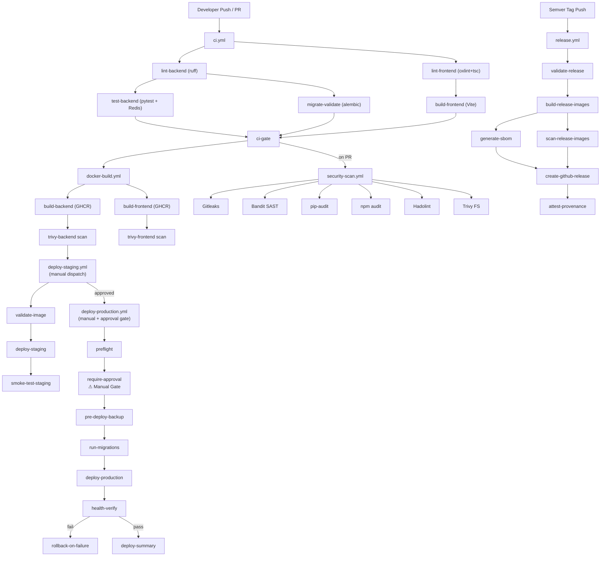

# VoiceGuard AI — CI/CD Architecture

## Overview

Phase 31 implements a secure, modular, automated CI/CD pipeline using **GitHub Actions**
and **GitHub Container Registry (GHCR)**.

The pipeline is composed of six independent workflow files, each with a single
responsibility. This design allows individual stages to be updated, re-run, or
debugged without affecting unrelated stages.

---

## Workflow Files

| File | Trigger | Purpose |
|------|---------|---------|
| `ci.yml` | Push, PR, dispatch | Consolidated CI: lint, test, build |
| `security-scan.yml` | Push, PR, weekly | Secret scan, SAST, dependency audit |
| `docker-build.yml` | CI passes on main, tags | Build & publish GHCR images |
| `deploy-staging.yml` | Manual dispatch | Deploy approved image to staging |
| `deploy-production.yml` | Manual dispatch + approval | Controlled production deploy |
| `release.yml` | Semver tag push | SBOM, GitHub Release, attestation |

> [!NOTE]
> `voiceguard-ci.yml` is the original Phase 30 workflow, retained for reference but
> disabled (path filter targets a non-existent directory).

---

## Workflow DAG



---

## Registry

All images are published to **GitHub Container Registry (GHCR)**:

| Image | Registry Path |
|-------|--------------|
| Backend | `ghcr.io/<org>/voiceguard-backend` |
| Frontend | `ghcr.io/<org>/voiceguard-frontend` |

**Authentication:** `GITHUB_TOKEN` with `packages: write` permission.
No external Docker Hub credentials required.

---

## Image Tagging Strategy

| Tag | When Applied | Mutable? |
|-----|-------------|---------|
| `sha-<short>` | Every push to main | No (SHA is immutable) |
| `latest` | Pushes to main only | Yes |
| `edge` | Pushes to develop | Yes |
| `stable` | Stable release (not RC) | Yes |
| `v1.2.3` | Release tag | Yes |
| `sha256:<digest>` | GHCR content digest | No (use for production) |

> [!IMPORTANT]
> **Production deployments must use image digests (`sha256:...`), never mutable tags.**
> The `deploy-production.yml` workflow validates digest format before accepting input.

---

## Concurrency Policy

| Workflow | Cancel-in-progress | Reason |
|----------|-------------------|--------|
| `ci.yml` | Yes (PRs only) | Avoid stale PR CI runs |
| `security-scan.yml` | No | Never interrupt a security scan |
| `docker-build.yml` | No | Never cancel an image push mid-way |
| `deploy-staging.yml` | No | Prevent race conditions in staging |
| `deploy-production.yml` | No | NEVER cancel a production deploy |
| `release.yml` | No | Never cancel a release build |

---

## Branch Strategy

```
main        — Production-ready code. All CI must pass before merge.
develop     — Integration branch. CI runs on push. Edge images built.
feature/*   — Feature branches. CI runs on PRs to main/develop.
v*.*.*      — Release tags. Triggers release.yml.
```

---

## Environments

GitHub Environments provide deployment protection:

| Environment | Protection | Used By |
|-------------|-----------|---------|
| `staging` | None (auto) | deploy-staging.yml |
| `staging-validate` | None (auto) | deploy-staging.yml (image validation) |
| `production` | **Required reviewers** | deploy-production.yml |

> [!CAUTION]
> Configure the `production` GitHub Environment with **at least 2 required reviewers**
> from your production-approvers team. Without this, the approval gate has no effect.

---

## Local CI Pipeline

A full local CI simulation is available via:

```powershell
cd voiceguard-ai
backend\venv\Scripts\python.exe backend\scripts\run_local_ci.py
```

This runs 8 steps (AST check, Alembic, pytest, frontend lint, Vite build, Docker smoke test)
in ~43 seconds without requiring Docker or GitHub.

---

## CI/CD Test Suite

Automated verification of all workflow files:

```powershell
cd voiceguard-ai
backend\venv\Scripts\pytest.exe backend\tests\test_ci_cd.py -v
```

Tests verify: file existence, valid YAML, GHCR usage, secret handling,
concurrency policy, manual approval gate, branch restrictions, and more.

