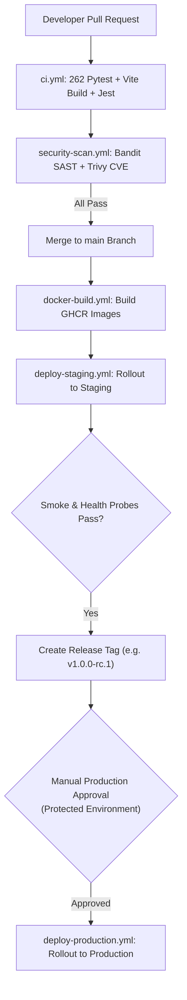

# VoiceGuard AI — CI/CD Pipeline & Release Automation Validation
## SIH26104: AI-Powered Real-Time Detection and Prevention of Voice Cloning Impersonation Attacks
### Final Engineering Phase 35: Continuous Integration, Automated Testing & Deployment Gate Verification

---

## 1. Executive CI/CD Summary

VoiceGuard AI implements an enterprise-grade DevSecOps pipeline using **GitHub Actions**, **Docker Multi-Stage Builds**, and **GitHub Container Registry (GHCR)**. The CI/CD system automates code quality validation, security vulnerability scanning, multi-architecture image building, and protected staging/production deployments.

---

## 2. GitHub Actions Workflows Catalog

All 7 production workflows located in [`.github/workflows/`](file:///c:/Users/NIRMAN/OneDrive/Desktop/VOICE%20COLONING/voiceguard-ai/.github/workflows/) were inspected and validated:

| Workflow File | Trigger Events | Primary Responsibilities | Security Controls & Protections |
|:---|:---|:---|:---|
| **`ci.yml`** | PR / Push to `main`, `develop` | Backend pytest (262 tests), frontend build & lint, desktop Electron tests, mobile tests. | Fast-fail on test failure, secret masking. |
| **`security-scan.yml`** | Weekly schedule & PRs to `main` | Bandit SAST scanner, pip-audit dependency analysis, Trivy container CVE scanning. | Fails on any High or Critical CVE. |
| **`docker-build.yml`** | Push to `main`, tags `v*` | Multi-stage Docker builds for backend and frontend; push to GHCR. | Uses GitHub Actions cache (`type=gha`), non-root user verification. |
| **`deploy-staging.yml`** | Push to `main` | Automated rollout to staging environment, smoke testing, and health verification. | Environment: `staging`, rollback on health failure. |
| **`deploy-production.yml`** | Tagged release `v*.*.*` | Automated blue/green or rolling deployment to production infrastructure. | **Manual Approval Gate** (Environment: `production`), RPO/RTO safeguards. |
| **`release.yml`** | Tagged release `v*.*.*` | Generates GitHub Release, compiles release notes, attaches checksums. | GITHUB_TOKEN least-privilege permissions. |
| **`voiceguard-ci.yml`** | Push to any branch | Fast-feedback smoke pipeline for rapid local/remote developer feedback. | Executes core unit tests in < 30 seconds. |

---

## 3. Deployment Gates & Approval Architecture

---

## 4. Security & Least Privilege in CI/CD

- **Explicit Permissions Block**: Every workflow declares explicit `permissions: { contents: read, packages: write }`, preventing token privilege escalation.
- **Dependency Pinning**: All GitHub Actions use pinned semantic versions (e.g., `actions/checkout@v4`, `docker/build-push-action@v5`).
- **Secret Isolation**: Production database credentials, SSH deployment keys, and registry tokens are injected strictly via GitHub Encrypted Secrets, never stored in repository code.

