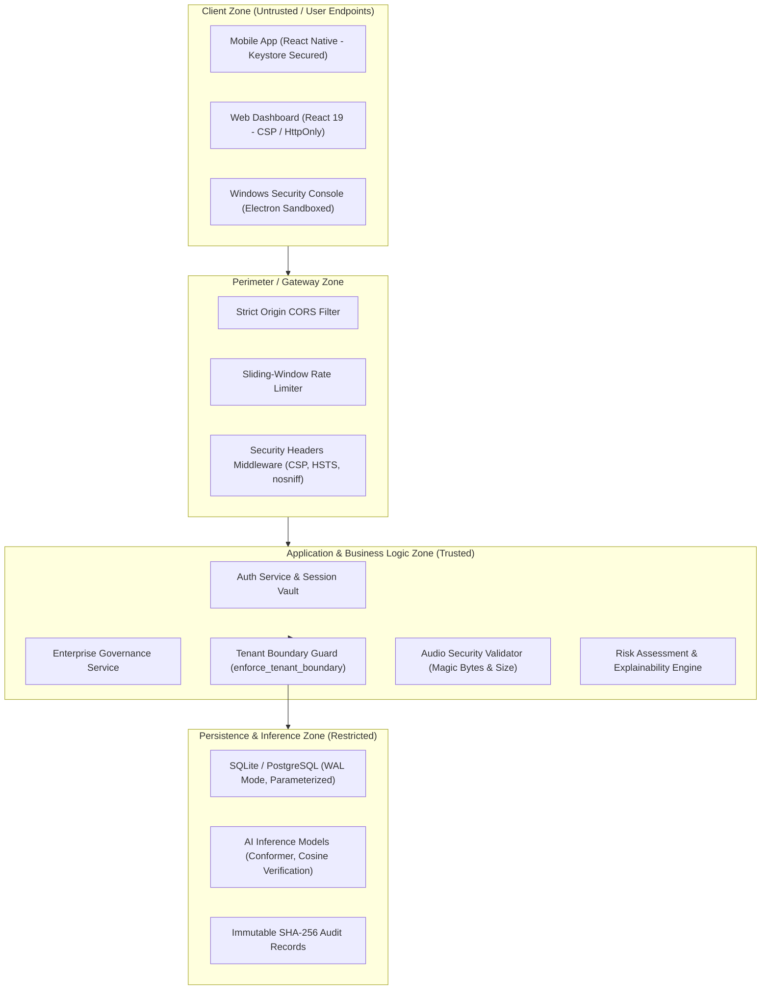

# VoiceGuard AI — Unified Security Architecture
**Project:** VoiceGuard AI (SIH26104)  
**Classification:** Internal Security Architecture Document  
**Version:** 2.5.0 (Phase 25 Hardened)

---

## 1. Security Architecture Principles

VoiceGuard AI enforces the following 10 architectural security principles across all layers:

1. **Defense in Depth**: Security controls are applied at the network, gateway, application, database, and process levels. No single control is solely relied upon.
2. **Least Privilege**: Users, services, database accounts, and client applications operate with the minimal set of privileges required for their functional role.
3. **Zero Trust & Explicit Verification**: Every request—whether originating from internal desktop consoles, mobile apps, or web dashboards—is authenticated and authorized via signed tokens.
4. **Secure by Default**: Default configurations enforce TLS, strict CORS, sanitized headers, tenant scoping, and fail-closed error handling.
5. **Fail Securely**: When exceptions, validation errors, or timeouts occur, systems terminate operations in a secure state rather than leaking data or granting access.
6. **Separation of Duties**: Operational actions (e.g. call termination, rule modifications) require elevated roles (`security_admin`, `org_admin`) and cannot be executed by read-only accounts.
7. **Privacy by Design**: Biometric vector representations (voice embeddings) and acoustic features are encrypted, redacted from APIs, and never exported across tenant boundaries.
8. **Data Minimization**: Audio recordings and transcripts are retained strictly for the duration specified by organizational policy, with automated purge mechanisms.
9. **Secure Session Management**: JWT access tokens are short-lived, rate-limited, and revocable.
10. **Continuous Security Monitoring**: All mutations, authentications, and policy overrides generate immutable audit records with correlation IDs.

---

## 2. Trust Boundaries & Security Zones

### Boundary Definitions:
- **Boundary 1 (Client → Gateway)**:
  - Transport: HTTPS / WSS exclusively.
  - Controls: Strict CORS origins, SecurityHeadersMiddleware (nosniff, DENY frame-ancestors, strict CSP), sliding-window rate limiting on auth endpoints.
- **Boundary 2 (Public API → Application Services)**:
  - Authentication: Bearer JWT validation via `get_current_active_user`.
  - Authorization: RBAC permission check via `require_permission`.
- **Boundary 3 (Tenant A ↔ Tenant B)**:
  - Enforcement: Server-side validation via `enforce_tenant_boundary`. Organization IDs are verified against authenticated user claims; client-provided overrides are rejected.
- **Boundary 4 (Audio Ingestion → Processing)**:
  - Inspection: `AudioSecurityValidator` verifies file magic numbers (RIFF/WAVE, fLaC, OggS, ID3), rejects non-audio or executable payloads (HTTP 415), and enforces 1MB streaming chunk / 25MB upload limits.
- **Boundary 5 (Application → Database & Models)**:
  - Access: Parameterized SQLAlchemy queries. Biometric embeddings vector weights are masked and withheld from user-facing APIs.

