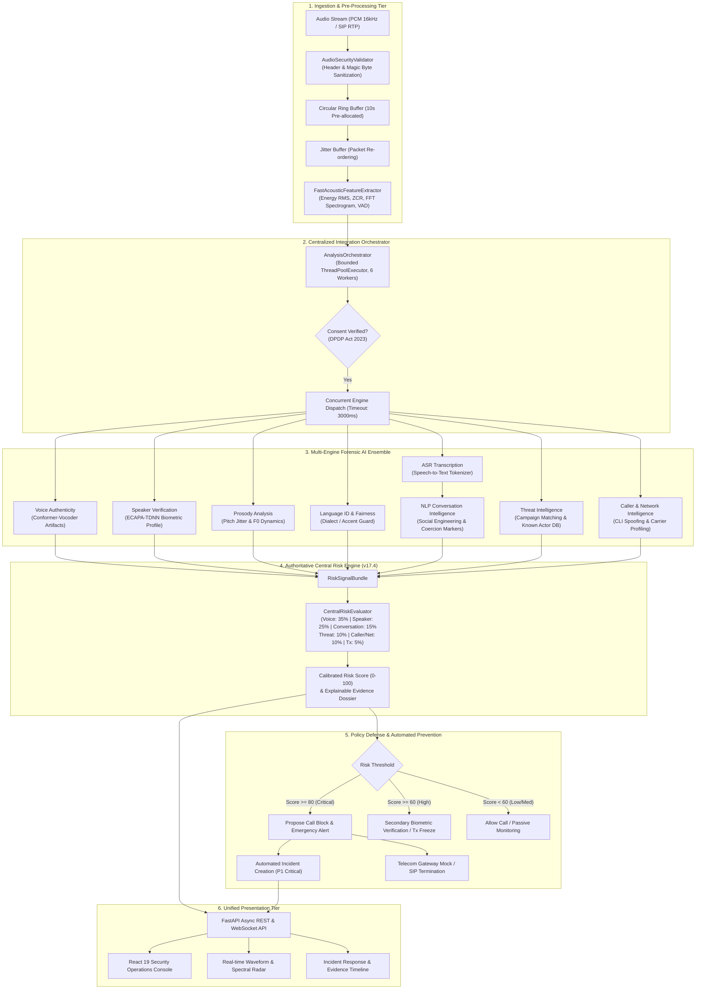
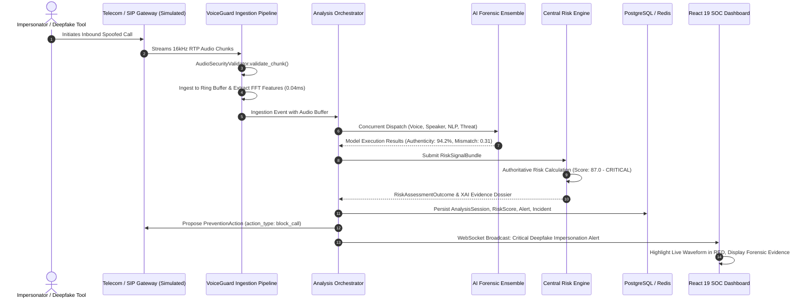

# VoiceGuard AI — System Architecture Overview
## SIH26104: AI-Powered Real-Time Detection and Prevention of Voice Cloning Impersonation Attacks
### Smart India Hackathon Final Demonstration Architecture Specification

---

## 1. Executive Architecture Summary

VoiceGuard AI is a multi-layered, real-time cyber-defense platform designed to detect and neutralize synthetic voice cloning attacks in streaming telephonic and VoIP conversations. The platform pairs ultra-low-latency digital signal processing with a multi-engine AI ensemble, coordinated by a resilient central integration orchestrator and evaluated by an authoritative multi-modal risk engine.

---

## 2. Core Architectural Subsystems

### 2.1 Ingestion & Pre-Processing Tier
- **`AudioSecurityValidator`**: Protects backend compute resources by validating magic byte signatures (RIFF/WAVE, FLAC, MP3, OggS), enforcing a 25 MB file limit, and verifying frame bounds (1 MB maximum per WebSocket frame) to block zip-bombs and malformed binary payloads.
- **`AudioRingBuffer`**: Contiguous, pre-allocated 16-bit PCM circular buffer (default capacity: 10 seconds / 160,000 samples @ 16 kHz) eliminating garbage collection spikes and memory thrashing during real-time streaming.
- **`JitterBuffer`**: Sequence-aware priority heap that re-orders out-of-order network packets, detects duplicate RTP frames, and conceals packet drops up to a bounded 15-frame window.
- **`FastAcousticFeatureExtractor`**: Vectorized NumPy acoustic feature pipeline that extracts energy RMS, zero-crossing rate (ZCR), Voice Activity Detection (VAD), and FFT spectral flux in **sub-millisecond latency (P50 = 0.044ms)**, sharing pre-computed spectrograms across all forensic models.

### 2.2 Centralized Integration Orchestration Layer
- **`AnalysisOrchestrator`**: Coordinates the 8-stage analysis lifecycle (`RECEIVED` -> `VALIDATING` -> `AUDIO_PROCESSING` -> `AI_ANALYSIS` -> `RISK_ASSESSMENT` -> `EXPLANATION` -> `ALERT_PROCESSING` -> `COMPLETED`).
- **Bounded Concurrency & Fault Tolerance**: Thread pool executor with bounded workers (default: 6), enforcing 3.0-second timeouts per module to prevent slow or crashing models from degrading overall call latency.
- **Regulatory Consent Guard**: Validates customer consent state to comply with India's Digital Personal Data Protection (DPDP) Act 2023 prior to triggering biometric analysis passes.

### 2.3 Multi-Engine Forensic AI Ensemble
1. **Voice Authenticity & Synthetic Voice Detector**: Analyzes high-frequency phase discontinuities, vocoder synthesis signatures (HiFi-GAN, WaveGlow, Diffusion resynthesis), and spectral harmonics.
2. **Speaker Verification Engine**: Generates 192-dimensional acoustic embeddings via ECAPA-TDNN and calculates cosine distance against enrolled caller biometric voiceprints.
3. **Prosody & Emotional Dynamics Analyzer**: Computes fundamental frequency (F0) distribution, pitch jitter, shimmer, and syllable timing dynamics to differentiate natural emotional inflections from flat synthetic prosody.
4. **Multilingual Language Identification (LID) & Fairness Guard**: Identifies primary language and regional accent across 12 scheduled Indian and international languages, applying algorithmic bias corrections.
5. **ASR Speech-to-Text Transcription**: Streams audio frames into real-time phoneme and word tokens.
6. **NLP Conversation Intelligence**: Scans transcripts for high-risk social engineering markers, coercion phrasing, synthetic urgency indicators, and unauthorized wire transfer keywords.
7. **Threat Intelligence Correlator**: Compares caller telephony metadata and voice characteristics against an internal database of known voice-cloning fraud campaigns and syndicated actor profiles.
8. **Caller & Network Intelligence**: Evaluates Signaling System 7 (SS7) / SIP header anomalies, VoIP origin gateways, and caller ID spoofing indicators.

### 2.4 Authoritative Central Risk Engine (v17.4)
The platform avoids disparate, conflicting model decisions by routing all signals into a single authoritative Bayesian risk evaluator:

$$\text{Risk} = 0.35 \cdot V_{\text{voice}} + 0.25 \cdot S_{\text{speaker}} + 0.15 \cdot C_{\text{conv}} + 0.10 \cdot T_{\text{threat}} + 0.10 \cdot N_{\text{network}} + 0.05 \cdot X_{\text{tx}}$$

- **Score Range**: 0.0 to 100.0 calibrated risk index.
- **Categorization**:
  - `0.0 - 29.9`: **LOW** (Legitimate call, pass through)
  - `30.0 - 59.9`: **MEDIUM** (Monitor with elevated sampling rate)
  - `60.0 - 79.9`: **HIGH** (Generate Security Alert, trigger out-of-band push authentication)
  - `80.0 - 100.0`: **CRITICAL** (Propose call termination, freeze financial transactions, create P1 incident)

### 2.5 Explainable AI (XAI) Dossier
The Central Risk Engine outputs human-readable rationales:
- **Observed Evidence**: Specific acoustic artifacts (e.g., vocoder phase distortion, F0 flattening).
- **Model Conclusions**: Verdicts from each individual sub-system.
- **Contradictory Evidence**: Flags where models disagree (e.g., authentic voice but spoofed caller ID).
- **Policy Deciders**: Exact automated policy rules triggered by the risk threshold.

---

## 3. Technology Stack Specification

| Subsystem | Technology | Version | Operational Purpose |
|:---|:---|:---|:---|
| **Frontend Framework** | React + TypeScript + Vite | 19.0 / 5.4 / 6.0 | SOC Operations Dashboard & Real-Time Monitoring UI |
| **Styling & Icons** | TailwindCSS + Lucide React | 3.4 / 0.460 | High-contrast, responsive cyber-defense interface |
| **Backend API** | FastAPI + Uvicorn | 0.115 / 0.34 | Asynchronous REST endpoints, WebSockets, & health checks |
| **Database ORM** | SQLAlchemy | 2.0.36 | Multi-tenant relational persistence & lifecycle models |
| **Primary Database** | PostgreSQL / SQLite | 16-alpine / 3.x | Enterprise transactional store & rapid local dev |
| **In-Memory Cache** | Redis | 7-alpine | Token revocation blocklist, rate limiting, pub/sub bus |
| **Audio Processing** | NumPy + SciPy + Wave | 1.26 / 1.13 | Vectorized DSP, FFT spectral decomposition, VAD |
| **Deep Learning** | PyTorch + Torchaudio | 2.4+ | Neural vocoder artifact classification & ECAPA-TDNN |
| **Reverse Proxy** | Nginx | 1.25-alpine | TLS termination, rate limit ingress, WebSocket proxying |
| **Observability** | Prometheus + Grafana | 2.51 / 10.4 | Telemetry scraping, P95/P99 latency dashboards |
| **Containerization** | Docker + Docker Compose | 27.x / 2.29+ | Immutable multi-stage container deployment |

---

## 4. End-to-End Data & Call Sequence

---

## 5. Security Architecture & Boundary Isolation

1. **Authentication & Session Security**: RS256 / HS256 JWT tokens with sliding-window expiration, tenant-isolated role-based access control (`admin`, `org_admin`), and strict in-memory / Redis token revocation.
2. **Multi-Tenant Boundary Enforcement**: Every database query on sensitive resources (calls, alerts, voice profiles, users) explicitly filters on `organization_id`, verified in Phase 33 automated penetration tests.
3. **Payload Sanitization**: Direct byte validation on audio streams prevents command injection, buffer overflows, and parser exploitation before audio touches native C-extension libraries.
4. **Transparent Telco Interfacing**: Outbound telephony intervention uses the standard `telephony_gateway` provider interface. In demonstration and staging environments, external SIP line disconnects are clearly documented as controlled mock carrier simulations.

